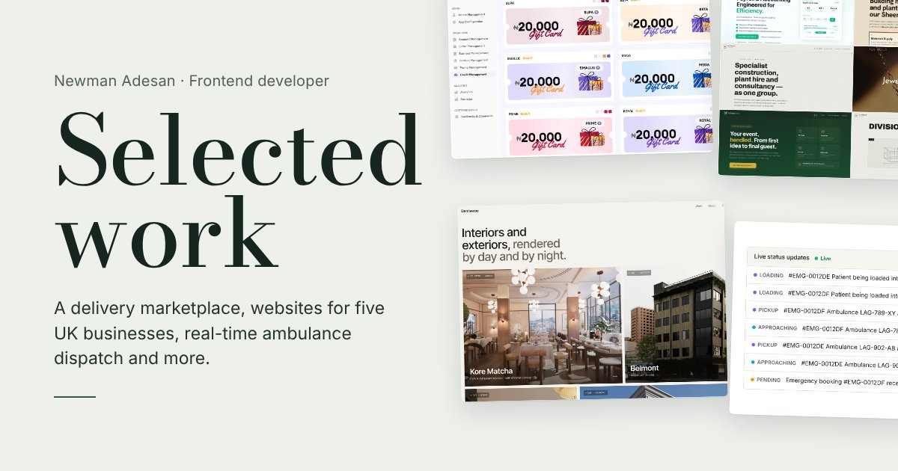

<a href="https://newmanadesan.vercel.app"></a>

# Newman Adesan

Frontend developer and software solutions analyst. I build web products for clients with React, Next.js and TypeScript. Before I write any code, I work out how the business actually runs.

**[See the case studies →](https://newmanadesan.vercel.app)** · [LinkedIn](https://www.linkedin.com/in/newman-adesan-74ba22210) · [newmanadesan@gmail.com](mailto:newmanadesan@gmail.com)

## Selected work

| Project | What it is | Live |
| :-- | :-- | :-- |
| **Swyftng** | Multi-service ordering and delivery marketplace. I have built its web platform since the MVP in May 2024, through five major versions on one codebase. | [swyftng.com](https://swyftng.com) |
| **Demiverse** | Showcase site for an architectural visualisation studio, with day-to-night scroll scenes that drop 0 frames under a 4× CPU slowdown. | [demiverse-site.vercel.app](https://demiverse-site.vercel.app) |
| **Shkula** | Multi-school management platform: the public website, then the super-admin dashboard used to oversee more than ten schools. | [Dashboard demo](https://multi-school-data-management-interf.vercel.app/admin) |
| **UK business websites** | Five sites for UK small businesses: a builders' merchant, a construction group, a payroll bureau, a jewellery dealer and an event planner. | [amstradersuk.com](https://amstradersuk.com) · [rfgrouplimited.com](https://rfgrouplimited.com) · [xsairesources.com](https://xsairesources.com) · [iq2gold.com](https://iq2gold.com) · [letsgolimes.com](https://letsgolimes.com) |
| **Ambulance dispatch platform** | Real-time request and dispatch: requests, offers and booking updates reach each side over Socket.IO. | Not launched yet |

The full write-ups, including GloBam, BA Digi Marketing and my analysis work, are on [the site](https://newmanadesan.vercel.app).

**Tools I use most:** React · Next.js · TypeScript · Tailwind CSS · TanStack Query · Zustand · Firebase · Socket.IO

<details>
<summary><b>About this repository</b></summary>

<br>

This repository is the source of [newmanadesan.vercel.app](https://newmanadesan.vercel.app). It is built with Next.js 16 (App Router), TypeScript and Tailwind CSS 4, and exported as a static site.

```bash
npm install
npm run dev      # http://localhost:3000
npm run build    # static site in out/
```

- `content/projects.ts` holds every word on the site. Edit this file, not the components.
- `app/page.tsx` is the home page. `app/work/[slug]/page.tsx` renders one case study per project.
- `public/images/<project>/` holds screenshots, and `public/videos/<project>/` holds recordings (an MP4 plus a poster JPG). Don't put images under `public/work/`, because the case-study routes use that path.

</details>
